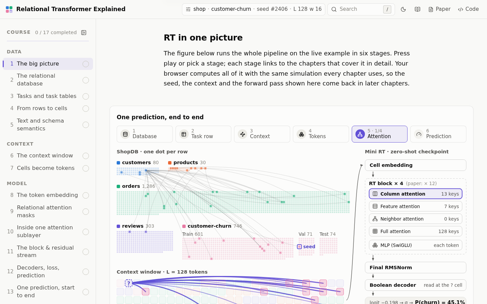

# Relational Transformer Explained

**An interactive course on the Relational Transformer, with a real (scaled-down) model running in your browser.**

**[Open the site →](https://arthursudbrackibarra.github.io/relational_transformer_explained/)**



The Relational Transformer (RT) is a foundation model for relational databases: pretrained on some databases, it
makes predictions on a database it has never seen, with no retraining, because every cell of every table becomes a
token and attention follows the database's own keys (Ranjan et al., *Relational Transformer: Toward Zero-Shot
Foundation Models for Relational Data*, ICLR 2026, [arXiv 2510.06377](https://arxiv.org/abs/2510.06377)).

This site teaches how RT works one step at a time. A mini RT, trained for the site, runs in the browser on four
small synthetic databases. Every figure is computed live by that model, so you can change the input and see what
each step does to it.

## What you will learn

The course has 17 chapters in four parts. Each chapter ends with a short quiz.

| Part | Chapters |
|---|---|
| **Data** | 1 The big picture · 2 The relational database · 3 Predictive tasks and task tables · 4 From rows to cells · 5 Text and schema semantics |
| **Context** | 6 Building the context window · 7 Cells become tokens |
| **Model** | 8 The token embedding · 9 Relational attention masks · 10 Inside one attention sublayer · 11 The RT block and the residual stream · 12 Decoders, loss and prediction · 13 One prediction, start to end |
| **Learning & results** | 14 Pretraining, zero-shot, fine-tuning · 15 Zero-shot playground and ablations · 16 What the paper found · 17 How this simulation was built and verified |

Along the way you will:

- follow one prediction (will this customer churn?) from the raw tables to the final probability;
- watch the context sampler pick the rows the model sees, and see which cells become tokens;
- inspect every attention mask (column, feature, neighbor, full) on a real context, and the scores behind it;
- step through chapter 13, which shows every matrix and weight of a single forward pass;
- use the playground to edit labels, shuffle column names, shrink the context or switch layers off, and watch the
  prediction change.

## Other features

- **Questions & answers** (`/#/qa`): longer answers to questions readers asked, checked against the official code.
- **Search** over every chapter and answer.
- **Light, dark and reading modes**, and a phone layout.
- **Certificate of completion**: tick all 17 chapters and pass a 15-question final quiz to get a PDF or PNG
  certificate with a QR code, which anyone can check on `/#/certificate/verify`.

## How faithful it is

Every operation mirrors the paper-era official code ([snap-stanford/relational-transformer](https://github.com/snap-stanford/relational-transformer)
at commit `2a899c8`). Only the size and the data are reduced:

|  | paper | this site |
|---|---|---|
| d_model / heads / blocks | 256 / 8 / 12 | 64 / 4 / 4 |
| context length L / BFS width w | 1024 / 256 | 128 / 16 |
| data | RelBench | 4 synthetic databases (ShopDB held out for zero-shot) |
| precision | bf16 on GPUs | float32 on CPU |

The checks behind that claim, all reproducible from this repository:

- **Model.** The TypeScript forward pass (`src/engine/model`) matches a PyTorch port (`python/rt_model.py`) to within
  3 × 10⁻⁶. That port matches the official `rt/model.py` class, loaded with the same weights, to within 2 × 10⁻⁶
  (`python/parity.py`, `public/data/verification.json`).
- **Preprocessing and sampling.** The TypeScript versions of the Rust `pre.rs` and `fly.rs` reproduce 2,144 contexts
  token for token against an independent Python re-implementation, with no mismatch.
- **Spec.** Every behaviour the site depicts is written down, with citations to the paper and the code, in
  `research/RT_TECHNICAL_SPEC.md`.

Chapter 17 on the site shows these results in detail.

## Run it locally

You need Node 24 and npm.

```bash
npm install
npm run dev        # http://localhost:5173
npm test           # engine, parity, quiz and certificate tests
npm run build      # static site in dist/
```

Pushes to `main` are tested, built and deployed to GitHub Pages by `.github/workflows/deploy.yml`.

The trained weights, embeddings and training curves are committed under `public/data/`, so the site needs no Python.
To retrain the mini RT or rerun the parity checks, see [`python/README.md`](python/README.md).

## Repository layout

- `src/engine/`: the simulation engine in plain TypeScript (database generators, preprocessing, sampler, masks, model).
- `src/chapters/`: the 17 chapters, one folder each.
- `src/qa/`: the Questions & answers page and its entries.
- `src/certificate/`: the final quiz, the certificate (drawn on a canvas, saved as PDF or PNG) and its verification.
- `src/components/`: shared UI and visualization components.
- `python/`: text embeddings (all-MiniLM-L12-v2), training of the mini RT, parity checks.
- `public/data/`: precomputed embeddings, trained weights, training curves, verification results.
- `research/`: the technical spec and research notes.
- `docs/`: the build plan and the chapter briefs.

### Questions & answers

Each answer is one file in `src/qa/entries/`. In Claude Code, `/rtquestion <question>` (the skill in
`.claude/skills/rtquestion/`) researches a new question against the official repository, writes the entry, checks
the build and pushes it.

### Certificate

The site has no server, so the certificate ID is computed in the browser: it is a SHA-256 checksum over the name, the
date, the score and the chapter count. It catches an edited certificate, but anyone who reads the code could compute
one, and both certificate pages say so. The quiz lives in `src/certificate/quiz.ts`. Never change the ID scheme in
`src/certificate/seal.ts`: every certificate already issued would stop verifying (`certificate.test.ts` pins it).

## Credits

- The Relational Transformer paper and code: Rishabh Ranjan et al. (Stanford University, Kumo AI, University of
  Oxford and SAP), [paper](https://arxiv.org/abs/2510.06377) and [code](https://github.com/snap-stanford/relational-transformer).
  This site is an independent educational project, not affiliated with the authors.
- Text embeddings: [all-MiniLM-L12-v2](https://huggingface.co/sentence-transformers/all-MiniLM-L12-v2).
- Reading-mode font: [Libron](https://github.com/nicoverbruggen/libron) (SIL OFL 1.1), in `src/styles/fonts/libron/`.
- Built by Arthur Sudbrack Ibarra.
